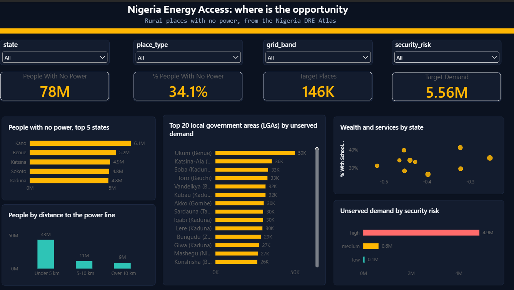

# NGN DR Energy: Nigeria energy access analysis

**Where in Nigeria do people live without electricity, and where is the best opportunity for distributed renewable energy (DRE)?**

I cleaned a settlement-level dataset in Python, stored it in MySQL, answered five business questions with SQL, and built a Power BI dashboard.

## Key findings

1. **About 77.7 million people (34% of the people in the data) live in places with no power.** Villages and small towns hold 82% of that gap. Kano has the most people without power (6.1 million), and the top 10 states, all in the north, hold 57%.
2. **Where the opportunity is biggest.** The top 10 states hold 55% of the unserved demand in rural places. Ukum, Katsina-Ala and Vandeikya (Benue) and Soba and Kubau (Kaduna) are among the largest LGAs by demand. Gada (Sokoto) has the highest demand per place and the highest risk-adjusted score among the top 20 LGAs.
3. **Grid or off-grid.** Among rural places with no power, 68% of people are within 5 km of a power line, 18% are 5 to 10 km away, and 14% (8.9 million people) are more than 10 km away.
4. **Ability to pay is low and roads are scarce.** In the 10 states with the most unserved demand, the wealth index is negative everywhere, and only 8% to 15% of rural places without power have main road access.
5. **Security risk covers almost the whole market.** 87.5% of unserved demand is in high-risk areas and only 1% is in low-risk areas, so risk is treated as a cost to plan for, not a filter.

## How it was built

| Step | Tool | File |
|---|---|---|
| Explore the data | Python notebook | `notebooks/01_explore_data.ipynb` |
| Clean data and add new columns | Python | `src/clean_data.py` |
| Load the clean table into MySQL | Python | `src/load_to_mysql.py` |
| Create the table and answer five questions | SQL | `sql/01_create_database.sql` |
| Dashboard | Power BI | `powerbi/NGN_DR_Energy.pbix` |

## The five questions

1. How big is the energy access gap, and where is it?
2. Which states and LGAs (local government areas) offer the best opportunity?
3. Grid or off-grid: where does each make sense?
4. Can customers pay, and is there productive demand?
5. How much does security risk reduce the opportunity?

## Definitions

- **Power status** comes from `overlap_percentage`, the share of a place that is lit at night: 50 or more is "Has power", above 0 and below 50 is "Some power", and 0 is "No power".
- **Place type** comes from population: Village (under 1,000), Small town (1,000 to 4,999), Town (5,000 to 19,999), City (20,000 or more).
- **Rural** means a village or small town. **Target places** are rural places with no power (145,628 places).
- **Grid band** is the distance to the nearest power line: under 5 km, 5 to 10 km, over 10 km.
- **Opportunity score (0 to 100)** is a weighted mix of ranked values for target places: demand 30%, sunshine 20%, wealth 20%, distance from the power line 15%, and extra users (school or clinic, road access) 15%.
- **Risk-adjusted score** multiplies the score by 1.0 (low risk), 0.9 (medium) or 0.8 (high).

The weights and risk factors are my own choices, not part of the dataset.

## How to run it

1. Download the Nigeria DRE Atlas settlement file and save it as `data/raw/nigeria_dre_atlas_settlements.csv`.
2. Install the tools: `pip install -r requirements.txt`.
3. Clean the data: `python src/clean_data.py`.
4. Run `sql/01_create_database.sql` in MySQL Workbench to create the `ngn_dre` database and the `settlements` table.
5. Load the data: `python src/load_to_mysql.py` (it asks for your MySQL password).
6. Open `powerbi/NGN_DR_Energy.pbix` and click **Refresh**.

## Limits to keep in mind

- The data is a **snapshot with no dates**, so it can't show trends.
- **Power status uses night-time light** as a stand-in for electricity, so small or dim places with power can be missed.
- The **demand** column is modelled from building counts, and the data does not state its unit.
- **Wealth values are missing** for about 5% of places, mostly in central states. They get a neutral score and are flagged.
- The **four packed fatality numbers** per place have an unknown meaning, so I treat their sum as a rough measure only.
- **Farm values are LGA-level**, not village-level.

## Data source

Nigeria Distributed Renewable Energy (DRE) Atlas, settlement level, from [energydata.info](https://energydata.info). Check the dataset page for its licence and cite it if you reuse this work.

Author: Emmanuel Twumasi Kwame Yeboah 